<picture>
  <source media="(prefers-color-scheme: dark)" srcset="assets/masthead-dark.svg">
  
</picture>

  
  
  

<picture>
  <source media="(prefers-color-scheme: dark)" srcset="assets/sec-editorial-dark.svg">
  
</picture>

<picture>
  <source media="(prefers-color-scheme: dark)" srcset="assets/quote-dark.svg">
  
</picture>

Soy estudiante de tercer año de **Ingeniería de Software y Negocios Digitales** en la ESEN (El Salvador). Me enfoco en **backend y nube**: APIs REST con Node.js y TypeScript, bases de datos relacionales e infraestructura en AWS con Terraform. Este perfil funciona como mi cuaderno de laboratorio: aquí documento lo que construyo, lo que aprendo y lo que se rompe en el camino.

<picture>
  <source media="(prefers-color-scheme: dark)" srcset="assets/stack-dark.svg">
  
</picture>

<picture>
  <source media="(prefers-color-scheme: dark)" srcset="assets/sec-experimentos-dark.svg">
  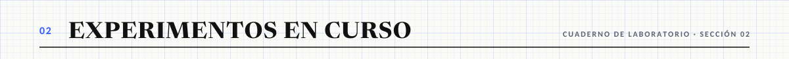
</picture>

| Estado | Experimento | Notas |
|:---:|---|---|
| 🧪 | **Programa de AWS** | Empiezo en diciembre: servicios y arquitectura en la nube. |
| 📐 | **Portafolio personal** | En diseño: definiendo la idea, el contenido y la tecnología antes de construir. |
| 🗣️ | **Inglés técnico** | Práctica de conversación para entrevistas. |
| 🔭 | **Métricas confiables** *(próximo)* | Agente de IA que responde solo con métricas certificadas: PostgreSQL + MongoDB, modelos y pruebas en dbt, CI con GitHub Actions y contexto vía MCP. |
| ✅ | **[Cloud DevSecOps Labs](https://github.com/JhonnatanPenate/cloud-devsecops-labs)** | 18 laboratorios en AWS, documentados con una etiqueta por lab. |

<picture>
  <source media="(prefers-color-scheme: dark)" srcset="assets/sec-mapa-dark.svg">
  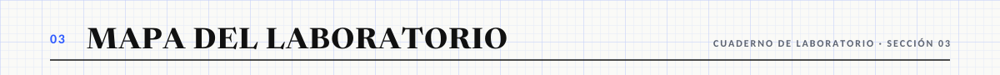
</picture>

<picture>
  <source media="(prefers-color-scheme: dark)" srcset="assets/capas-dark.svg">
  
</picture>

Evidencia por capa →
<a href="https://github.com/JhonnatanPenate/hospital-management-database">Bases de datos</a> ·
<a href="https://github.com/JhonnatanPenate/cloud-devsecops-labs">CI/CD y seguridad</a> ·
<a href="https://github.com/JhonnatanPenate/cloudshop-supernube">Nube e IaC</a> ·
<a href="https://github.com/JhonnatanPenate/enterprise-app-modernization">Microservicios</a>

<picture>
  <source media="(prefers-color-scheme: dark)" srcset="assets/sec-destacados-dark.svg">
  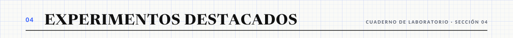
</picture>

  <a href="https://github.com/JhonnatanPenate/cloud-devsecops-labs"><picture><source media="(prefers-color-scheme: dark)" srcset="assets/exp-01-dark.svg">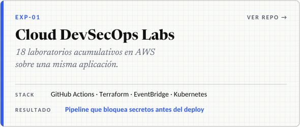</picture></a>
  <a href="https://github.com/JhonnatanPenate/enterprise-app-modernization"><picture><source media="(prefers-color-scheme: dark)" srcset="assets/exp-02-dark.svg">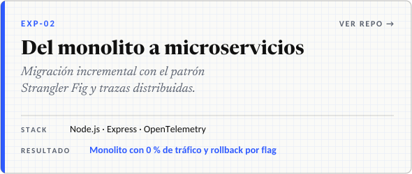</picture></a>

  <a href="https://github.com/JhonnatanPenate/nasa-maze"><picture><source media="(prefers-color-scheme: dark)" srcset="assets/exp-03-dark.svg">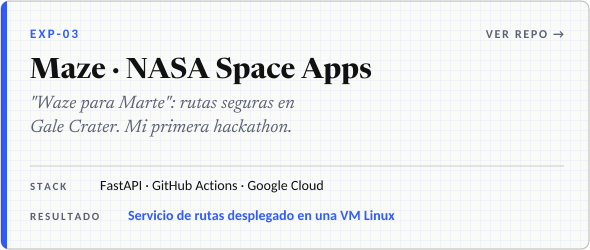</picture></a>
  <a href="https://github.com/JhonnatanPenate/cloudshop-supernube"><picture><source media="(prefers-color-scheme: dark)" srcset="assets/exp-04-dark.svg">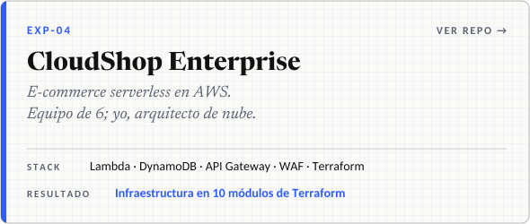</picture></a>

  <a href="https://github.com/JhonnatanPenate/hospital-management-database"><picture><source media="(prefers-color-scheme: dark)" srcset="assets/exp-05-dark.svg">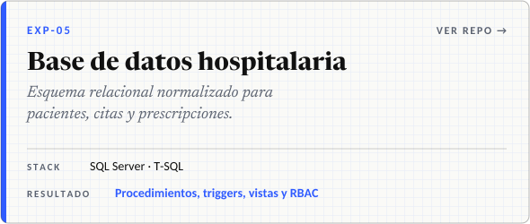</picture></a>
  <a href="https://github.com/JhonnatanPenate/SivarCuponera"><picture><source media="(prefers-color-scheme: dark)" srcset="assets/exp-06-dark.svg">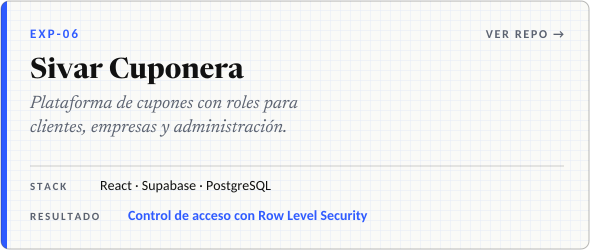</picture></a>

<picture>
  <source media="(prefers-color-scheme: dark)" srcset="assets/sec-fallos-dark.svg">
  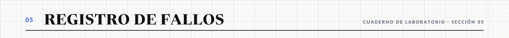
</picture>

> Lo que se rompió, por qué y qué cambié. Cada entrada es real.

<b>FALLO-01 · NASA Space Apps (nov 2026)</b> — 6 despliegues fallidos antes del primero en verde

 

| | |
|---|---|
| **Qué pasó** | El pipeline falló 6 veces antes del primer despliegue exitoso en la VM de Google Cloud. |
| **Causas** | El repo no estaba clonado en la VM, IAP sin autorización, permisos de `docker.sock` y un archivo faltante. Después, un choque de puertos. |
| **Cómo lo resolví** | Revisé cada error del pipeline uno por uno, trabajando con agentes de IA para diagnosticar y corregir. |
| **Lección** | Organizar el despliegue desde el inicio del proyecto, no al final. |

<b>FALLO-02 · Laboratorios Vijosa (2026)</b> — EC2 no funcionó para el entorno de pruebas

 

| | |
|---|---|
| **Qué pasó** | Los intentos de desplegar el backend en EC2 no funcionaron. |
| **Cómo lo resolví** | Cambié a AWS Elastic Beanstalk, con la infraestructura en Terraform, y el equipo de planta pudo probar el sistema a distancia. |
| **Lección** | Si un servicio no encaja con el caso, cambiar de enfoque antes que forzarlo. |

<b>PRUEBA-03 · Cloud DevSecOps Labs (sep 2026)</b> — un secreto falso, a propósito

 

| | |
|---|---|
| **Qué hice** | Subí un commit con un secreto de prueba para comprobar que el pipeline lo detectara. |
| **Resultado** | El pipeline lo bloqueó antes del despliegue; luego revertí el commit y desplegué limpio. |
| **Lección** | Un control de seguridad solo cuenta si lo pruebas fallando. |

<picture>
  <source media="(prefers-color-scheme: dark)" srcset="assets/sec-contacto-dark.svg">
  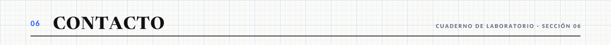
</picture>

  ¿Una práctica, un proyecto o una buena conversación sobre backend y nube? Escríbeme.  
  
  

<i>Cuaderno de laboratorio · Nº 01 · escrito en Markdown, con SVG generados en Python · El Salvador.</i>

