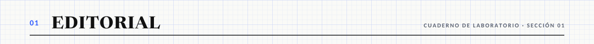
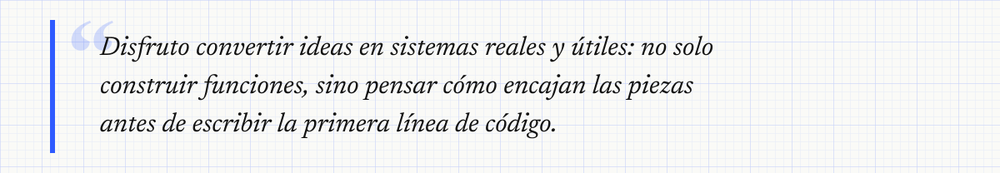

<picture>
  <source media="(prefers-color-scheme: dark)" srcset="assets/masthead-dark.svg">
  
</picture>

  
  
  

<picture>
  <source media="(prefers-color-scheme: dark)" srcset="assets/sec-editorial-dark.svg">
  
</picture>

<picture>
  <source media="(prefers-color-scheme: dark)" srcset="assets/quote-dark.svg">
  
</picture>

Soy estudiante de tercer año de **Ingeniería de Software y Negocios Digitales** en la ESEN (El Salvador). Me enfoco en **backend y nube**: APIs REST con Node.js y TypeScript, bases de datos relacionales e infraestructura en AWS con Terraform. Este perfil funciona como mi cuaderno de laboratorio: aquí documento lo que construyo, lo que aprendo y lo que se rompe en el camino.

<picture>
  <source media="(prefers-color-scheme: dark)" srcset="assets/stack-dark.svg">
  
</picture>

<picture>
  <source media="(prefers-color-scheme: dark)" srcset="assets/sec-experimentos-dark.svg">
  
</picture>

| Estado | Experimento | Notas |
|:---:|---|---|
| 🧪 | **Programa de AWS** | Empiezo en diciembre: servicios y arquitectura en la nube. |
| 📐 | **Portafolio personal** | En diseño: definiendo la idea, el contenido y la tecnología antes de construir. |
| 🗣️ | **Inglés técnico** | Práctica de conversación para entrevistas. |
| 🔭 | **Métricas confiables** *(próximo)* | Agente de IA que responde solo con métricas certificadas: PostgreSQL + MongoDB, modelos y pruebas en dbt, CI con GitHub Actions y contexto vía MCP. |
| ✅ | **[Cloud DevSecOps Labs](https://github.com/JhonnatanPenate/cloud-devsecops-labs)** | 18 laboratorios en AWS, documentados con una etiqueta por lab. |
